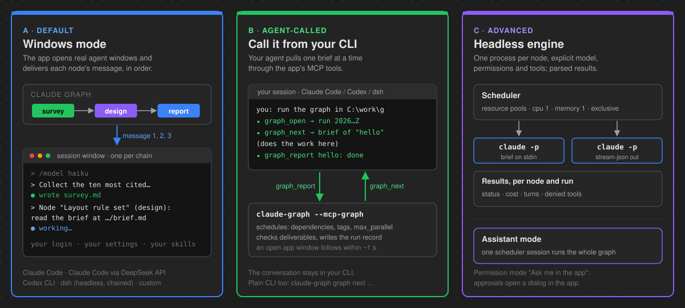
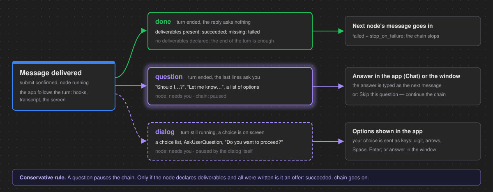

<p align="center">
  
</p>

<p align="center">
  
  <br>
  <sub>A three-node run: survey, then layout rule set, then a two-page report. Recorded with the bundled fake CLI, so no tokens were spent.</sub>
</p>

<h1 align="center">Claude Graph</h1>

<p align="center">
  <a href="https://github.com/Zwl20085/claude-graph/actions/workflows/ci.yml"></a>
  <a href="package.json"></a>
  <a href="LICENSE"></a>
</p>

Some engineering work is too big for one agent session: a literature survey, a rule set
derived from it, a checker script, a report on both. Claude Graph lets you draw that work as
a graph. Each node is one task with its own brief and its own definition of done. Wires set
the order. Press **Run all** and the app hands the nodes, one after the other, to the coding
agent you already use (Claude Code, Codex CLI, DeepSeek's `dsh`, or your own), under your own
login and settings. Every brief, reply, question and deliverable is written as plain files
next to `graph.json`, so the record lives with the work.

## Three ways to use it

<p align="center">
  
</p>

**A. Windows mode (default).** Run all opens a real agent session in its own window, one
per chain of connected nodes, and delivers each node's message into it in dependency order,
as if you had typed it. The agent runs under its own settings, skills and hooks. When it asks
you something, the chain pauses and the app shows the question.
*Pick this when* you want to watch the work and keep talking to the agent afterwards.

**B. Call it from your CLI.** You stay in your own Claude Code, Codex or dsh session. The
agent asks Claude Graph for the next brief through MCP tools, does the work in that session,
and reports back. The app schedules, checks deliverables and keeps the record; if its window
is open on the folder, it follows the run live.
*Pick this when* you already work in a terminal agent and want the graph as its to-do list.

**C. Advanced: headless engine and Assistant mode.** The headless engine starts one
`claude -p` process per node with an explicit model, permission mode and tool list, keeps
heavy nodes apart with resource pools, and parses each result into the Results tab. Assistant
mode instead hands the whole graph to one Claude Code session that schedules it itself.
*Pick this when* you want unattended, per-node control (headless) or a conversational
orchestrator (Assistant).

## 60-second start

1. Build and start the app (see [Install](#install)): `npm install && npm run tauri dev`.
2. **File → New graph…** or **Open graph…**: a graph is a folder holding `graph.json`.
3. **Add node** (Ctrl+N, or double-click the canvas). Type what the step should do in the
   **Prompt** tab. Drag from one card's handle to the next to wire them.
4. **Run all** (Ctrl+Enter). A session window opens and the first node's message goes in.
   Cards turn blue while running, green when done; violet means **needs you**.

To try it without spending tokens, point the app at the bundled fake CLI
([Development](#development)) and open `examples/hello-pipeline`.

## The graph

| Idea | What it means |
|---|---|
| **Node = one task** | A title, a prompt or a brief, an optional model and harness. One card on the canvas. |
| **Wires = order** | A node starts only after every upstream node succeeded. Cycles are refused when you draw them. |
| **Brief template** | The **Brief** tab: goal, acceptance criterion, scope in/out, already known, deliverables, do-nots. The app renders it to `nodes/<id>/brief.md` on save, with the upstream nodes' deliverables and replies included as data. |
| **Deliverables define done** | Files the node must write into `nodes/<id>/deliverables/`. A node is `succeeded` only if each one exists and was written during this run. |
| **Resource tags** | `cpu`, `memory`, `gpu`, `exclusive` or any word: each is a pool with a capacity (default 1), so two heavy solves never overlap. Applied by the headless engine and the agent-called mode; `max_parallel` (default 2) caps everything. |
| **One chain = one session** | In Windows mode, nodes connected by wires share one agent session, so a later node remembers what earlier ones did. Separate chains get separate windows, up to `max_parallel` at once. |

Node statuses, as the legend next to the minimap shows them:

| Status | Meaning |
|---|---|
| `pending` · `queued` | not started · waiting for its turn, or for its message to be taken |
| `running` | the agent is working on it (blue ring) |
| **needs you** (`waiting`, violet) | it asked you something: answer in the **Chat** tab |
| `succeeded` · `failed` | done with deliverables written · the agent or the CLI failed |
| `blocked` (orange) | headless only: the node ended with `## Status: BLOCKED` |
| `skipped` · `cancelled` | an upstream node stopped the chain · you cancelled it |

The inspector has four tabs: **Prompt · Brief · Chat · Results**. Run options are **Run all**,
**Run from selected** (that node and everything downstream) and **Rerun failed** (the failed,
blocked, skipped and cancelled nodes of the shown run, with their dependents). The file
format is in [docs/graph-format.md](docs/graph-format.md), the brief in
[docs/NODE_TEMPLATE.md](docs/NODE_TEMPLATE.md).

## Windows mode in depth

<!-- Screenshots are refreshed per release; the ones not matching the current UI were removed from this README. -->
<p align="center">
  
  <br>
  <sub>One session for the whole chain. Each node's message goes in turn; the window stays open afterwards so you can keep talking.</sub>
</p>

In this mode the app is a messenger. It passes no flags you did not set and parses no status
protocol; the agent's own configuration decides permissions, skills, hooks and the model.

**Message delivery.** Text typed into a busy terminal gets lost, so delivery is careful:

- *The message is your text, verbatim.* A one-line prompt (up to 2000 characters) is typed as
  is; a multi-line prompt (up to 8000) goes in as one bracketed paste. A node with a brief, or
  with input from another session, gets one line: `Node "<title>" (<id>): read the brief at
  <path> and do it; write all outputs to <deliverables dir>.` A node that names a model gets
  `/model <name>` first (Claude Code only).
- *Readiness gate.* The app types only when the output has been quiet for 1 s and the input
  box is on screen (or quiet for 5 s and no dialog). While a dialog is open it never types; it
  tells you to answer it, and waits.
- *Retry ladder.* After typing, Enter is sent separately and the app waits for the agent to
  confirm the submit (Claude Code's `UserPromptSubmit` hook; for Codex and custom harnesses,
  the text leaving the input area). If the text is still in the box, Enter again, up to three
  more times; otherwise clear the line with Ctrl+U and retype, up to three cycles. Still not
  submitted: the node fails with "could not submit the message after 3 attempts; see the window".

Each node's turn is saved as `reply.md`: the messages and the agent's final text when the
hooks report it, otherwise the lines the turn put on screen, replayed through a terminal
emulator.

**Turn outcomes.** After a message is delivered, the app follows the turn through hook
payloads, the agent's transcript and the screen, and classifies it as exactly one of three:

<p align="center">
  
</p>

A toast says "Node X needs you", the top bar counts the nodes waiting, and the Chat tab shows
the question with one button per option, a box for your own answer and **Open window**. A
dialog answer is sent as the keys the agent expects (digit, arrows, Space, Enter; verified
with Claude Code 2.1.319). **Skip this question — continue the chain** ends the node by its
deliverables. You can also answer directly in the window; the app notices. Every question
and dialog, and how it was answered, goes to `runs/<run>/<node>/questions.jsonl`.

The offer rule is conservative on purpose: "Want me to also add tests?" pauses the node,
unless the node declares deliverables and all of them were written.

**Harnesses.** A harness is the agent CLI a session runs. Pick the graph default under
**Settings → Default harness**, override it per node, and manage profiles with **Manage…**. A
chain is split into separate sessions where the harness changes; the next session gets the
upstream deliverables and replies through its brief.

| Harness (id) | How it runs | What it needs |
|---|---|---|
| Claude Code (`claude`, default) | Interactive session in a pty; turns tracked by hooks passed with `--settings` | Claude Code installed and logged in |
| Claude Code via DeepSeek API (`claude-deepseek`) | Claude Code pointed at DeepSeek's Anthropic-compatible API | Claude Code, and `DEEPSEEK_API_KEY` set before the app starts (the profile says `ANTHROPIC_AUTH_TOKEN=${DEEPSEEK_API_KEY}`) |
| Codex CLI (`codex`) | Interactive, `--no-alt-screen`; turn end through Codex `notify` | `codex` on PATH; the model is set in the profile, not per node |
| DeepSeek Harness dsh (`deepseek-harness`) | Headless, chained: one `dsh --profile headless --json` process per message, joined by `--session-id`; no dialogs | `dsh` on PATH, configured in `~/.dsh`; approvals it cannot ask for show as denied |
| Custom | Your command and args; idle marker, dialog markers, turn end by quiet time (default 8000 ms), Claude hooks or Codex notify | The profile; a graph that picks one with its own args or env asks for trust |

Profiles live in the app data folder of this machine, never in `graph.json`. An environment
value may say `${VAR}`; it is read from the app's environment at start and never stored. A
graph naming a harness this machine lacks refuses to start and names the node.

## Call it from your CLI

The direction flips: your agent calls the app. A session looks like this:

```
you:    run the graph in C:\work\my-graph
agent:  graph_open → 3 nodes, run 20261108T200336Z;  graph_next → brief of "hello"
agent:  (writes hello.txt) → graph_report {node_id: "hello", status: "done", summary: "…"}
agent:  graph_next → "join" (with the upstream summaries) … → done: true
```

| Tool | Arguments | Result |
|---|---|---|
| `graph_open` | `dir` (absolute), `new_run?` | Overview of the graph and a `run_id`; resumes the folder's unfinished agent run |
| `graph_next` | `dir`, `run_id`, `max?` (1–16), `retry?` | The full brief of each ready node, now `running`; or what the run waits on; or `done` |
| `graph_report` | `dir`, `run_id`, `node_id`, `status` (`done`/`failed`/`blocked`), `summary`, `question?`, `deliverables_written?` | The node's new status and the nodes that became ready |
| `graph_note` | `dir`, `run_id`, `node_id?`, `text` | Adds a line to the run log the app shows |
| `graph_status` | `dir`, `run_id?` | Table of node statuses |

The app checks `done` against the node's deliverables itself; `blocked` makes the node
**needs you** without skipping its dependents. For agents that prefer a shell there is a plain
CLI, `claude-graph graph open|next|report|note|status <dir>`, with these exit codes:

| Exit code | Meaning |
|---|---|
| 0 | OK |
| 1 | Error, with the message on stderr |
| 2 | Usage error |
| 3 | `next`: nothing is ready yet |
| 4 | `next`: every node is settled |

**Set it up** in **Settings → This machine → Use from your CLI**, which shows each snippet with
the path filled in and an **Add** button that does nothing until you confirm. `<exe>` is the
full path of `claude-graph.exe`.

Claude Code (user scope, or per project in `.mcp.json`):

```
claude mcp add --scope user claude-graph -- "<exe>" --mcp-graph
```

```json
{"mcpServers": {"claude-graph": {"command": "<exe>", "args": ["--mcp-graph"]}}}
```

Codex CLI: `codex mcp add claude_graph -- "<exe>" --mcp-graph`, which writes this block to
`~/.codex/config.toml`:

```toml
[mcp_servers.claude_graph]
command = 'C:\path\to\claude-graph.exe'
args = ["--mcp-graph"]
```

dsh: add this entry to `~/.dsh/cordis.patch.yml` (a YAML list), to
`~/.dsh/profiles/<p>/cordis.patch.yml`, or to a file passed with `--patch <file>`:

```yaml
- insert:
    - id: mcp-claude-graph
      name: '@deepseek-ai/dsh-mcp-client'
      config:
        serverName: claude-graph
        transport: stdio
        command: 'C:\path\to\claude-graph.exe'
        args: ['--mcp-graph']
```

A `/graph` slash command for Claude Code is in
[examples/claude-command-graph.md](examples/claude-command-graph.md). Rules, error codes and
files are in [docs/cli-addon.md](docs/cli-addon.md).

## Inbox: agent tasks from your Vindictive board

Mark a tip on the [Vindictive](https://github.com/Zwl20085/vindictive) board as `kind: agent`
and Claude Graph does the rest. With the Inbox enabled (top bar **Inbox**, off by default, one
machine only), the app scans the tips folder shortly after start, every 12 hours and on
**Scan now**. Each new or changed agent tip runs in its own session window, at most two at a
time. The outcome comes back into the tip: ⭐ result, ❓ questions (also when a permission dialog,
or Claude Code's start-up trust or MCP dialog, waits in the window) or ⚠ failed. Files, with the
prompt the agent was given, land in `agent/<tip id>/` next to the tips. A done tip's session
window closes by itself.

You answer a question by typing into the tip; the next scan runs it again. The tip text is
only ever handed to the agent as data in its brief. It never becomes a command, a path or a
setting, and your own Claude Code permission settings apply. How it works, the settings and the
safety rules are in [docs/INBOX.md](docs/INBOX.md). The contract between the two apps is
[docs/AGENT-PROTOCOL.md](docs/AGENT-PROTOCOL.md). An optional setting starts Claude Graph with
Windows.

## Advanced: headless engine and Assistant mode

Switch **Settings → Run in** from "Interactive windows (default)" to "Headless engine
(advanced)". Each node then runs as one `claude -p` process with the brief on stdin and
`stream-json` on stdout, every line kept in `events.jsonl`. A node succeeds when its reply
ends with `## Status: DONE` and its deliverables exist; `## Status: BLOCKED` makes it
`blocked` (orange) and skips its dependents; a Chat reply ending `## Status: DONE` turns it
`succeeded`, and **Rerun failed** runs the rest.

| Permission mode | Effect |
|---|---|
| Claude Code settings (recommended) | No `--permission-mode` flag: your own settings decide |
| `acceptEdits`, `default`, `plan`, `dontAsk`, `bypassPermissions` | Passed as `--permission-mode`; the last two need trust |
| Ask me in the app | A tool that needs approval opens a dialog in the app: **Allow once**, for this node, always for this graph, or **Deny** |

A headless run cannot ask in a terminal, so a tool your settings do not allow is refused: the
app shows a toast, marks the card and lists the denied tools in the Results tab.

**Assistant mode** (the **Assistant** tab of the side panel) starts one Claude Code session,
the *work scheduler*, and gives it the whole graph. It passes no model, permission or tool
flags (except the approval flags when the graph default is "Ask me in the app"), runs the
nodes itself, and reports back as Stage, Question, Decision, Note and Final cards. Talk to it
at any time; each message resumes the same session.

Details: [docs/ARCHITECTURE.md](docs/ARCHITECTURE.md) and
[docs/CLAUDE_CLI_NOTES.md](docs/CLAUDE_CLI_NOTES.md).

<p align="center">
  
</p>

## Everything stays in the graph folder

```
hello-pipeline/
|   graph.json                   nodes, edges, positions, settings
|   GRAPH_LOG.md                 one line per node per run
|
+---nodes
|   +---survey
|   |   |   brief.md             the brief as last saved
|   |   \---deliverables
|   |           survey.md        what the agent wrote
|   +---design   (brief.md, deliverables/check_rules.py, rules.md)
|   \---report   (brief.md, deliverables/report.md)
+---assistant                    Assistant mode only
|   |   session.json  journal.jsonl  CHARTER.md  PLAN.md  DECISIONS.md
|   \---turns\0001               prompt.md, events.jsonl, reply.md, stderr.log
\---runs
    \---20261108T200336Z         a Windows-mode run
        |   run.json             status, timings, sessions of every node
        +---sessions
        |   \---s1               one per chain (split where the harness changes)
        |           session.json
        |           transcript.log
        |           hooks.path   where this session's hooks live (app data folder)
        +---survey
        |       prompt.md        the brief that was sent
        |       reply.md         the node's turn as text
        |       result.md
        |       summary.json
        +---design
        |       (same files)
        |       questions.jsonl  every question or dialog, and how it was answered
        \---report
                (same files)
```

The hook files (`hooks.json`, `hooks.log`) live in the app data folder,
`<data_dir>/claude-graph/sessions/<run>-<graph hash>/<sid>/`, outside the folder the agents
can write to. A headless run adds `events.jsonl`, `messages.jsonl` and `stderr.log` per node;
an agent-called run adds `agent_log.jsonl`. Run ids are UTC timestamps, so `runs/` sorts by
time. Copy the folder and you copy the whole history.

## Trust and safety

A graph folder can come from someone else, so the app treats it as data.

**Never done.**

- No API keys and no account handling: the app runs the CLI you already have, under its
  login. A harness environment value like `${DEEPSEEK_API_KEY}` is read at start, never stored
  or logged.
- No flags you did not set: Windows mode and Assistant mode pass no permission or model flag
  unless you chose one on the node or in the graph.
- No credential files read: the app never reads, for example, `~/.dsh/.credentials.yaml`; a
  transcript path from a hook payload is read only if it is a local `.jsonl` under your home
  or the app's sessions folder.
- No shell: on Windows the CLI is never started through `cmd.exe`; npm shims are resolved to
  the real program. Each process sits in a kill-on-close Job Object (Windows) or a process
  group (Unix), so Cancel, exit or a crash ends the whole tree.

**Asks first.** Before the first run, and again whenever one of these changes, a **Trust this
graph?** dialog lists each item:

- a permission mode of `bypassPermissions` or `dontAsk`;
- an allowed tool containing `Bash`;
- an absolute working directory outside the graph folder;
- a node prompt starting with `!` (the agent would run it as a shell command);
- Claude Code project settings shipped in the graph or a working folder (`.claude/settings*.json`, `.mcp.json`);
- a non-default harness picked by the graph whose profile on this machine has its own args or env.

Node ids, allowed tools, deliverable paths, working directories and session ids are validated
on load and save; UNC and device paths are refused. The claude path is set per machine in
the app, never taken from `graph.json`.

## Status and limits

v0.6.0. Verified by hand on Windows 11 with Claude Code 2.1.319, Codex CLI 0.167.0 and dsh
0.2.1-rc.2 (dated notes in [docs/CLAUDE_CLI_NOTES.md](docs/CLAUDE_CLI_NOTES.md)). CI builds
and tests on Ubuntu and Windows.

Not verified yet:

- the macOS and Linux apps, by hand (CI covers the backend and frontend tests on Linux);
- Codex's folder-trust dialog (not shown on the test machine; its markers come from Codex's documented texts);
- an AskUserQuestion call with several questions (tabs), not probed with the real CLI;
- a question-and-answer round through a real dsh (the fake covers it), and dsh outside Windows.

On the roadmap: subgraphs, loops and conditionals, a git worktree per node, skipping nodes
whose inputs did not change, auto-layout.

## Install

There are no prebuilt binaries yet; build from source. You need Node 18+, Rust stable, and at
least one agent CLI (for the default harness, [Claude Code](https://docs.claude.com/en/docs/claude-code)
installed and logged in: `claude --version`). On Debian or Ubuntu, Tauri 2 also needs:

```bash
sudo apt-get install -y libwebkit2gtk-4.1-dev libgtk-3-dev \
  libayatana-appindicator3-dev librsvg2-dev libxdo-dev libssl-dev build-essential patchelf
```

```bash
git clone https://github.com/Zwl20085/claude-graph.git
cd claude-graph
npm install
npm run tauri dev      # development window
npm run tauri build    # installer and binary under src-tauri/target/release
```

`claude-graph <graph-dir> [--run]` opens a folder and optionally starts Run all. Under
`tauri dev` use `CLAUDE_GRAPH_OPEN=<absolute graph dir>` and `CLAUDE_GRAPH_AUTORUN=1`.

## Development

```bash
npx vitest run                        # frontend: graph helpers, stores, components, mock IPC
cd src-tauri && cargo test            # backend: scheduler, delivery, turns, harnesses, agent mode, e2e
cargo test --test real_claude -- --ignored --nocapture   # real CLI, uses your login
```

The `real_*` tests (`real_claude`, `real_terminal`, `real_harness`, `real_ask`, `real_dsh`)
are ignored by default; they use your login and spend tokens. Everything else runs against fake CLIs in
`scripts/`: `fake-claude.mjs` (headless, and interactive through `fake-claude-tty.mjs`),
`fake-codex.mjs`, `fake-dsh.mjs` and `fake-ask.mjs`. They write stub deliverables; markers
such as `FAKE_QUESTION`, `FAKE_DIALOG`, `FAKE_OFFER` or `FAKE_FAIL` in a node's prompt
exercise the turn outcomes and failures. To demo the app with no tokens:

```powershell
$env:CLAUDE_GRAPH_CLAUDE_BIN = "node `"$PWD\scripts\fake-claude.mjs`""
$env:CLAUDE_GRAPH_OPEN = "$PWD\examples\hello-pipeline"
npm run tauri dev
```

(macOS and Linux: the same two variables with `$PWD/scripts/fake-claude.mjs`.) The script
path must be absolute, and the claude path in the app settings must be empty, or it wins over
the variable. The design, the IPC contract and every decision are in
[docs/ARCHITECTURE.md](docs/ARCHITECTURE.md); read [CONTRIBUTING.md](CONTRIBUTING.md) before
changing the IPC contract.

## License

[MIT](LICENSE) © Wentao Zhang
